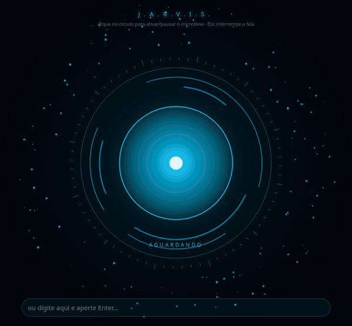

# J.A.R.V.I.S.

<p align="center">
  
</p>

Assistente de voz que roda no seu PC. Você fala, ele entende (Whisper, local), pensa com o Claude e
responde falando (voz Antonio), com o círculo animado reagindo à voz. Ele também controla o
computador: abre e fecha apps, abre sites e pastas, mexe no volume e na música, bloqueia a tela,
roda comandos e pesquisa na internet.

O "cérebro" é o Claude Code logado com a sua assinatura do Claude, então não precisa de chave de API.
Cada pedido conta no limite de uso da sua assinatura.

## Quick start

Precisa de Linux com Python 3, Chromium e o [Claude Code](https://claude.com/claude-code) instalado e logado
(rode `claude` no terminal uma vez para fazer login). O ffmpeg é opcional e dá o efeito metálico na voz.

```bash
git clone https://github.com/NicholassweetDev/jarvis.git
cd jarvis
./jarvis.sh
```

Na primeira vez o script cria o ambiente Python, instala as dependências e baixa o modelo do Whisper.
Depois a janela do Jarvis abre e ele já está ouvindo.

## Como usar

Exemplos: "abre a calculadora", "fecha o Firefox", "aumenta o volume", "próxima música",
"abre o YouTube", "abre minha pasta de downloads", "como está o tempo em São Paulo?",
"quanto de espaço tem no meu disco?".

- **Clicar no círculo** pausa ou retoma o microfone.
- **Esc** interrompe a fala.
- Também dá para digitar na caixa de baixo.

## Configuração (`.env`)

| Variável | O que faz |
|---|---|
| `JARVIS_WAKE_WORD=1` | Só responde quando você começa com "Jarvis..." |
| `JARVIS_USER_NAME` | Como ele te chama |
| `JARVIS_VOICE` | `pt-BR-AntonioNeural` ou `pt-BR-FranciscaNeural` |
| `JARVIS_WHISPER` | `base` é mais rápido, `medium` é mais preciso |
| `JARVIS_MODEL` | Vazio usa o padrão do Claude Code; `sonnet` é mais rápido e gasta menos do limite |

## Arquivos

- `server.py`: servidor, reconhecimento de voz, chamada ao Claude Code e síntese de voz
- `tools.py`: o que o Jarvis pode fazer no PC (adicione novas ferramentas aqui)
- `tools_cli.py`: permite ao Claude Code acionar essas ferramentas pelo terminal
- `static/index.html`: a interface com o círculo
- `docs/`: o GIF de demonstração e a imagem de social preview do repositório

## Licença

[MIT](LICENSE): pode usar, modificar e distribuir, desde que mantenha o aviso de copyright.
